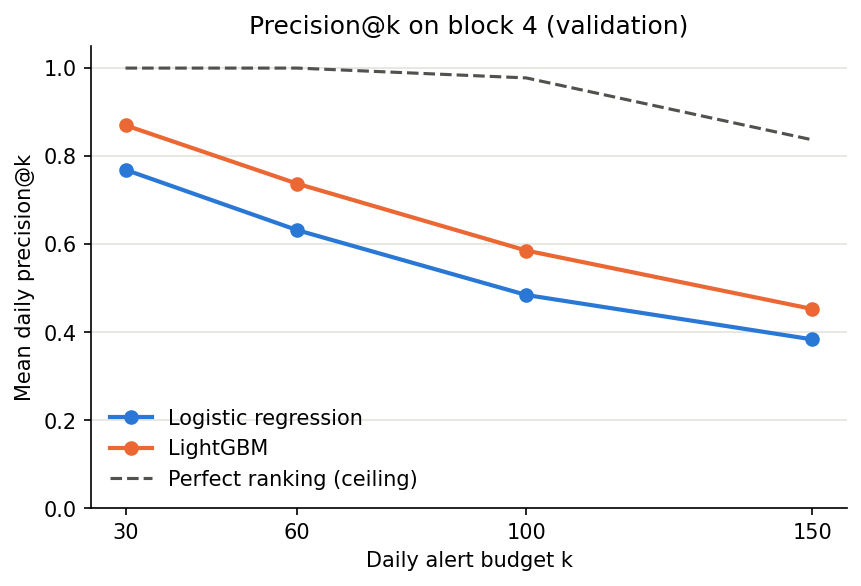

# Fraud Detection Under Analyst Capacity Limits

Evaluating fraud detection models by daily alert budget, monetary savings and performance drift.

**CS5998 Capstone Project** | Master of Data Science & Artificial Intelligence
**Author:** K.K.I. Kasthurirathne (268465B)
**Supervisor:** Dr. Sandareka Wickramanayake
**Status:** Milestone 2 (Technical Checkpoint) in progress

---

## Project Scope

| Dimension | Choice |
|---|---|
| Problem type | Detection (binary classification under a fixed review budget) |
| Data type | Tabular, time-stamped transactions |
| Technique category | Supervised ML + unsupervised anomaly detection |
| System context | End-to-end pipeline, comparative analysis, decision-support dashboard |
| LLM used inside the system | **None** |

---

## Overview

Card fraud is not stopped by a model alone. It is stopped by a small team of analysts working through a queue of alerts the model has ranked, and that team can only review a limited number of cases per day. What matters in practice is not overall accuracy but how many of the cases reviewed tomorrow are genuinely fraud, and how much money they represent.

Most public work on the IEEE-CIS dataset ranks models by ROC-AUC on a random split. That measures ordering across the whole dataset and says nothing about the top of a short daily queue, nothing about money saved, and nothing about how fast a model goes stale. A random split also lets future transactions influence a model tested on earlier ones, which cannot happen in deployment.

This project builds a complete fraud detection pipeline and evaluates it the way a fraud operations team would experience it: under a fixed daily alert budget, scored in both detection and financial terms, and tracked month by month.

### Research questions

- **RQ1** Under a fixed daily alert budget, how much does LightGBM improve on a logistic regression baseline, and does that gap match what ROC-AUC suggests?
- **RQ2** Does adding an unsupervised anomaly score produce measurable lift under the same budget?
- **RQ3** Is it better to rank alerts by fraud probability or by expected monetary loss?
- **RQ4** How fast does a frozen model decay month over month, and how much does retraining recover?

---

## Dataset

**Primary:** IEEE-CIS Fraud Detection (Vesta Corporation, hosted on Kaggle)

- 590,540 labelled transactions, 20,663 fraudulent (~3.5%)
- Two tables joined on `TransactionID`; around 430 columns combined
- Time field spans roughly 182 days, giving six 30-day blocks
- Most column names are masked by the provider
- Only the labelled training files are used, as the competition test file has no public labels

**Raw data is not committed to this repository.** To get it:

1. Sign in to Kaggle, open the [IEEE-CIS Fraud Detection](https://www.kaggle.com/competitions/ieee-fraud-detection) competition and accept its rules.
2. On its Data tab, download `train_transaction.csv` and `train_identity.csv` (about 710 MB together; unzip them if they arrive as `.zip`). No other file is needed.
3. Put both files in `data/raw/` inside the project folder.

**Fallback:** Bank Account Fraud suite (Feedzai, NeurIPS 2022), used only if access to the primary dataset fails.

---

## Method

**Evaluation design.** Strict time-based split into six 30-day blocks. Train on blocks 1 to 3, tune on block 4, test once on blocks 5 and 6. A 7-day gap sits before each evaluation window to reflect real label delay. No random splitting at any stage.

**Models.**
1. Class-weighted logistic regression (baseline)
2. LightGBM on time-safe engineered features (improved)
3. LightGBM + Isolation Forest anomaly score, run with and without it as an ablation (hybrid)

**Alert policies.** Three ways of turning scores into daily work, each tested at budgets of 30, 60, 100 and 150 alerts per day:
- **A** Top-k by fraud probability
- **B** Top-k by expected loss (probability × amount)
- **C** No cap, flag whenever expected loss exceeds review cost

**Metrics.** PR-AUC and ROC-AUC for ranking; daily precision@k and recall@k at transaction and card level for operations; savings (fraud prevented minus review costs) for financial impact; monthly scores and PSI for drift. Bootstrap confidence intervals and paired tests confirm differences are real.

**Architecture.** The pipeline runs as four stages; see the [system architecture diagram](docs/architecture.md) for what each stage reads and writes, and which parts are planned for Milestone 3.

---

## Milestone 2 results (validation, block 4)

**These are validation results on block 4** (days 90-119: 98,615 transactions, 3,898 frauds), **not the final test.** Blocks 5 and 6 are scored once, in Milestone 3. Both models are trained on days 0-82, which end 7 days before block 4, and their settings are fixed in config, so block 4 was not used to tune either. Alerts follow Policy A (each day's top k transactions by fraud score), and each review costs $5.

| Metric | Logistic regression | LightGBM | Difference |
|---|---|---|---|
| ROC-AUC | 0.8469 | 0.8899 | +0.0430 (+5.1%) |
| PR-AUC | 0.4208 | 0.5310 | +0.1101 (+26.2%) |
| Precision@30 | 0.769 | 0.870 | +0.101 (+13.2%) |
| Precision@60 | 0.632 | 0.737 | +0.106 (+16.7%) |
| Precision@100 | 0.484 | 0.585 | +0.101 (+20.9%) |
| Precision@150 | 0.383 | 0.452 | +0.069 (+18.0%) |
| Recall@100 | 0.371 | 0.453 | +0.082 (+22.1%) |
| Savings at k = 100, over the 30 days | $136,186 | $193,318 | +$57,132 (+42.0%) |

Precision@k and recall@k are means over the 30 days. Savings = fraud amount caught - $5 x alerts sent. A perfect ranking would reach precision@k 1.000 / 1.000 / 0.978 / 0.837 for k = 30 / 60 / 100 / 150, because some days have fewer frauds than k.

**Preliminary answer to RQ1.** LightGBM beats the baseline at every budget: at k = 100, about 10 more of each day's 100 alerts are fraud, and it has the higher precision@100 on 28 of the 30 days. ROC-AUC rises by only 5.1%, against 13-21% for precision@k, so in absolute and relative terms the ROC-AUC gap understates the gain at a budget. Measured as the share of the room to a perfect ranking closed, ROC-AUC (28%) falls inside the precision@k range (15-44%), so the gain has to be measured at the budget the team actually works with. This rests on one validation month and has no confidence intervals yet; both come in Milestone 3.



Full table and all three figures: [reports/m2_comparison.md](reports/m2_comparison.md). RQ1 note and its limits: [reports/m2_results.md](reports/m2_results.md).

---

## Reproducing the results

**Needs:** Python 3.11, about 8 GB of free RAM (stage 1 peaks at about 7 GB while reading the CSVs) and about 1 GB of free disk. All settings, including the seed (42), are in [configs/config.yaml](configs/config.yaml).

**1. Set up**, from the project folder, after putting the data in `data/raw/` (see [Dataset](#dataset)):

```powershell
# Windows (PowerShell)
py -3.11 -m venv .venv
.venv\Scripts\Activate.ps1
pip install -r requirements.txt
```

```bash
# macOS / Linux
python3.11 -m venv .venv
source .venv/bin/activate
pip install -r requirements.txt
```

If PowerShell refuses to run `Activate.ps1`, first run `Set-ExecutionPolicy -Scope Process Bypass`, which lasts only for that window.

**2. Run**, with the virtual environment active (the same commands work in PowerShell and bash):

```bash
pytest -q                                    # unit tests on small synthetic data, no real data needed
python -m src.data.make_dataset              # stage 1: raw CSVs -> data/interim/
python -m src.features.build_features        # stage 2: train and block-4 tables -> data/processed/
python -m src.models.train --model baseline  # stage 3: reports/results_baseline.csv
python -m src.models.train --model lgbm      # stage 3: reports/results_lgbm.csv
python -m src.evaluation.compare             # stage 4: reports/m2_comparison.md, reports/figures/m2_*.png
```

Each stage reads the files saved by the stage before it, so run them in this order the first time. From a fresh clone the six commands took about 5 minutes on the author's laptop: about 1 minute for stage 1, 20 seconds for stage 2 and 0.5-1.5 minutes for each model (times vary between runs). With the pinned versions, the run reproduces the committed `reports/results_*.csv` files and `reports/m2_comparison.md` byte for byte. The figures come out pixel-identical, but their PNG files can differ in size, because the PNG encoder (Pillow, installed with matplotlib) is not pinned.

Optional: rerun the EDA notebook. This rewrites the notebook's outputs and the four `reports/figures/eda_*.png` figures.

```bash
python -m nbconvert --to notebook --execute --inplace notebooks/01_eda.ipynb
```

---

## Milestones

- [x] **Milestone 1** (Week 4, 25%) Project Definition
- [ ] **Milestone 2** (Week 8, 25%) Technical Checkpoint: preprocessing, EDA, baseline + improved model, architecture diagram, demo video
- [ ] **Milestone 3** (Week 12, 50%) Final report, code, reproducibility checklist

---

## References

- Dal Pozzolo et al. (2018). *Credit card fraud detection: a realistic modeling and a novel learning strategy.* IEEE TNNLS.
- Carcillo et al. (2021). *Combining unsupervised and supervised learning in credit card fraud detection.* Information Sciences.
- Bahnsen et al. (2015). *Example-dependent cost-sensitive decision trees.* Expert Systems with Applications.
- Le Borgne et al. (2022). *Reproducible Machine Learning for Credit Card Fraud Detection: Practical Handbook.*

---