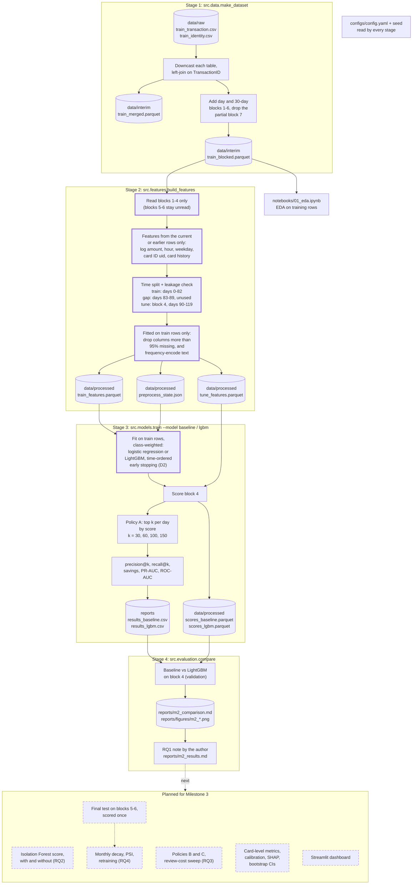

# System Architecture

The pipeline runs as four stages, each a script run with `python -m`. Each stage reads the files saved by
the stage before it, so a later stage can be rerun without repeating the slow earlier ones. Solid boxes are
built and run in Milestone 2. Dashed boxes are planned for Milestone 3. Boxes with a thick border are where
the time split is protected from leakage.

## Stages

| Stage | Command | Reads | Writes |
|---|---|---|---|
| 1 | `python -m src.data.make_dataset` | the two raw training CSVs | `data/interim/train_merged.parquet`, `data/interim/train_blocked.parquet` |
| 2 | `python -m src.features.build_features` | blocks 1-4 of `train_blocked.parquet` | `data/processed/train_features.parquet`, `tune_features.parquet`, `preprocess_state.json` |
| 3 | `python -m src.models.train --model baseline` (or `lgbm`) | the stage 2 files | `reports/results_{model}.csv`, `data/processed/scores_{model}.parquet` |
| 4 | `python -m src.evaluation.compare` | the stage 3 files of both models | `reports/m2_comparison.md`, `reports/figures/m2_*.png` |

Stage 1 is the only code that reads the raw CSVs. The competition test files have no labels and are never read.

## Leakage guards (thick borders)

- **Read blocks 1-4 only.** Stage 2 reads only blocks 1-4, so the final test blocks 5-6 are never loaded in
  Milestone 2.
- **Time split.** Training rows end 7 days before block 4 starts, for label delay. `check_no_leak` checks this
  in stages 1, 2 and 3.
- **Fitted on train rows only.** Column pruning, frequency encoding, the baseline's imputation, scaling and
  one-hot encoding, and LightGBM's early stopping use training rows only. LightGBM's early-stopping holdout is the last 14 days
  of the training window, after its own 7-day gap, so block 4 stays unseen by both models (decision D2).
- **Current or earlier rows only.** Each feature uses only the row itself or the card's earlier transactions,
  and no feature uses `isFraud`. Features are added to blocks 1-4 before the split, so block-4 rows keep their
  card's earlier transactions (decision D7). This is safe because a transaction is known when it happens; the
  7-day gap is for label delay, and labels are never used.

There is no LLM anywhere in the pipeline.
