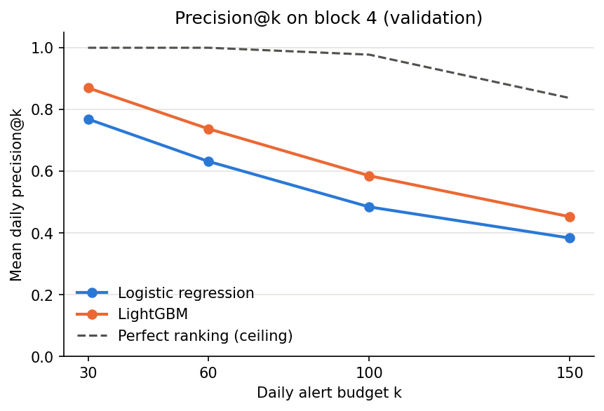
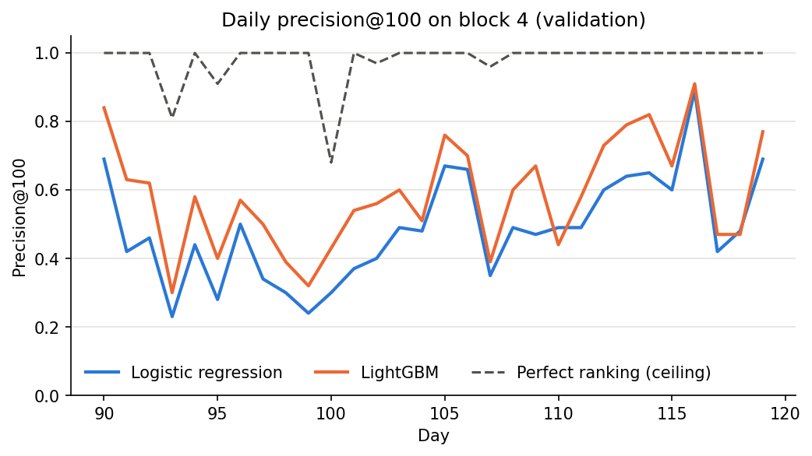
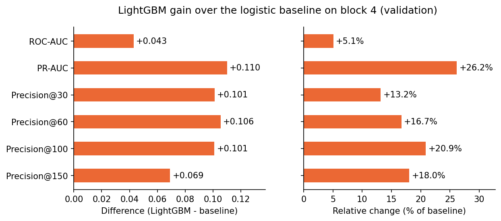

# Logistic regression vs LightGBM: validation (block 4)

Generated by `python -m src.evaluation.compare`. Do not edit by hand: a rerun overwrites this file.

Validation results on days 90-119: 98,615 transactions, 3,898 frauds. Not the final test, which is blocks 5-6, scored once in Milestone 3. Policy A (each day's top k transactions by fraud score), review cost $5 per alert.

| Metric | k | Logistic regression | LightGBM | Difference | Relative change |
| --- | --- | --- | --- | --- | --- |
| ROC-AUC | all | 0.8469 | 0.8899 | +0.0430 | +5.1% |
| PR-AUC | all | 0.4208 | 0.5310 | +0.1101 | +26.2% |
| Precision@k | 30 | 0.769 | 0.870 | +0.101 | +13.2% |
| Precision@k | 60 | 0.632 | 0.737 | +0.106 | +16.7% |
| Precision@k | 100 | 0.484 | 0.585 | +0.101 | +20.9% |
| Precision@k | 150 | 0.383 | 0.452 | +0.069 | +18.0% |
| Recall@k | 30 | 0.182 | 0.208 | +0.026 | +14.4% |
| Recall@k | 60 | 0.293 | 0.346 | +0.053 | +18.1% |
| Recall@k | 100 | 0.371 | 0.453 | +0.082 | +22.1% |
| Recall@k | 150 | 0.438 | 0.522 | +0.084 | +19.3% |
| Savings ($) | 30 | 49,872 | 65,722 | +15,850 | +31.8% |
| Savings ($) | 60 | 94,201 | 126,961 | +32,760 | +34.8% |
| Savings ($) | 100 | 136,186 | 193,318 | +57,132 | +42.0% |
| Savings ($) | 150 | 180,845 | 254,554 | +73,709 | +40.8% |

Difference = LightGBM - logistic regression. Relative change = difference / logistic regression. Precision@k and recall@k are means over days (D9); savings are totals over the window.

A perfect ranking (every fraud above every genuine transaction) would reach precision@k 1.000 / 1.000 / 0.978 / 0.837 for k = 30 / 60 / 100 / 150: on some days there are fewer frauds than k.

Daily precision@100: LightGBM is higher on 28 of 30 days, lower on 2 and equal on 0.

